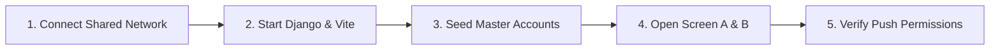

# JANMITRA — Push Notification Live Demonstration & Viva Guide

> **Project Title**: JANMITRA — Civic Issue Reporting & Management System  
> **Target Municipal Corporation**: Nagpur Municipal Corporation (NMC)  
> **Lead Presenter**: Faizan Rayeen (Citizen Portal Lead & Push Notifications Lead)  
> **Engineering Team**: ResolveIT (B.Tech Final Year Capstone Project)  
> **Document Version**: v3.7.0 (Day 37 Final Viva Guide)  
> **Purpose**: Step-by-step presentation script and live dual-screen demonstration guide for external examiners, technical viva, and project evaluation.

---

## Table of Contents
1. [Pre-Flight Setup Checklist (15 Minutes Before Viva)](#1-pre-flight-setup-checklist-15-minutes-before-viva)
2. [Dual-Screen Live Demo Procedure (Viva Presentation Script)](#2-dual-screen-live-demo-procedure-viva-presentation-script)
   - [Phase 1: Screen A (Phone) — Citizen Submits Civic Complaint](#phase-1-screen-a-phone--citizen-submits-civic-complaint)
   - [Phase 2: Screen B (Laptop) — Officer Real-Time Validation Alert](#phase-2-screen-b-laptop--officer-real-time-validation-alert)
   - [Phase 3: Screen B to Screen A — Officer Assigns Worker & Push Dispatched](#phase-3-screen-b-to-screen-a--officer-assigns-worker--push-dispatched)
   - [Phase 4: Background OS Notification Test (App Closed)](#phase-4-background-os-notification-test-app-closed)
3. [Offline & Safe Simulation Backup Instructions](#3-offline--safe-simulation-backup-instructions)
   - [Scenario A: College Wi-Fi / Firewall Blocks FCM Ports](#scenario-a-college-wi-fi--firewall-blocks-fcm-ports)
   - [Scenario B: Complete Offline Operation via CLI Dispatcher](#scenario-b-complete-offline-operation-via-cli-dispatcher)
   - [Scenario C: Browser Console Instant Emulation (`window.janmitraFCM`)](#scenario-c-browser-console-instant-emulation-windowjanmitrafcm)
4. [Master Demo Credentials Quick Reference](#4-master-demo-credentials-quick-reference)
5. [Anticipated Examiner Questions & Model Answers](#5-anticipated-examiner-questions--model-answers)

---

## 1. Pre-Flight Setup Checklist (15 Minutes Before Viva)

Follow this 5-point setup to guarantee a smooth presentation:



| Step | Action | Command / Target | Verification |
| :---: | :--- | :--- | :--- |
| **1** | **Shared Network** | Connect Laptop and Phone to the same mobile hotspot (e.g. *Faizan-Hotspot*). | Both devices share local subnet IP (e.g. `192.168.43.x`). |
| **2** | **Start Backend** | `python manage.py runserver 0.0.0.0:8000` | Backend accessible at `http://<LAPTOP_IP>:8000/api/v1/health/`. |
| **3** | **Start Frontend** | `npm run dev -- --host` | Frontend accessible at `http://<LAPTOP_IP>:5173`. |
| **4** | **Seed Demo DB** | `python manage.py seed_demo_accounts --clean` | 25 accounts, 12 categories, 20 Nagpur complaints seeded. |
| **5** | **Pre-Check SW** | Chrome DevTools &rarr; *Application &rarr; Service Workers* | Status: **Activated and is running** (`/firebase-messaging-sw.js`). |

> [!TIP]
> **Mobile Browser Security Flag (Chrome on Android)**:  
> If demonstrating over HTTP on local IP (`http://192.168.x.x:5173`), enable Service Workers on the phone by opening:  
> `chrome://flags/#unsafely-treat-insecure-origin-as-secure` &rarr; add your IP URL &rarr; Relaunch Chrome.

---

## 2. Dual-Screen Live Demo Procedure (Viva Presentation Script)

This rehearsed procedure creates an unforgettable impression by demonstrating real-time civic synchronization between a citizen on a mobile phone and an NMC municipal officer on a laptop.

```
┌─────────────────────────────────┐           ┌─────────────────────────────────┐
│       SCREEN A: PHONE           │           │       SCREEN B: LAPTOP          │
│   (Citizen / Field Worker)      │           │    (NMC Department Officer)     │
│   Logged in: Citizen Ward 2     │           │   Logged in: PWD Officer        │
│   URL: /citizen/submit          │           │   URL: /officer/validation      │
└─────────────────────────────────┘           └─────────────────────────────────┘
```

---

### Phase 1: Screen A (Phone) — Citizen Submits Civic Complaint

#### Presenter Dialogue (Faizan Rayeen):
> *"Respected Examiners, I will now demonstrate the Citizen Grievance Portal from a mobile device. Here on Screen A, Citizen Priya Sharma of Ward 2 (Dharampeth) has encountered a severe asphalt crater on West High Court Road. She files the issue in real time with photo proof and GPS coordinates."*

#### Actions on Screen A (Phone):
1. Open JANMITRA Citizen Portal (`/citizen`).
2. Point out the **NMC Civic Advisory Broadcast Banner** at the top.
3. Tap **Report New Issue** (`/citizen/submit`).
4. Select:
   - **Department / Category**: *Roads & Infrastructure &rarr; Pothole Repair*
   - **Ward**: *Ward 2 - Dharampeth*
   - **Description**: *"Severe asphalt crater near Shankar Nagar Square causing traffic hazards."*
   - **GPS Coordinates**: Tap **Detect Location** (auto-fills `21.1448`, `79.0682`).
5. Tap **Submit Complaint**.

#### What Happens Instantly:
- A navy-blue in-app toast slides into view on the phone:
  - **Header**: `NMC Alert`
  - **Title**: `Complaint Received: NMC-2026-A4829`
  - **Body**: `Your civic complaint has been submitted and queued for triage.`
  - **CTA**: `View →` button.
- The **Notification Bell** counter increments from `0` to `1`.

---

### Phase 2: Screen B (Laptop) — Officer Real-Time Validation Alert

#### Presenter Dialogue:
> *"Now, immediately observe Screen B on the laptop, which represents the workstation of Shri V. R. Sharma, Executive Engineer for PWD at Nagpur Municipal Corporation. Notice how the backend dual-channel pipeline has synchronized the new complaint in real time without refreshing the page."*

#### Actions on Screen B (Laptop):
1. Show the Officer Dashboard (`/officer`).
2. An alert chime sounds, and a foreground toast banner appears:
   - **Title**: `New Grievance Submitted: NMC-2026-A4829`
   - **Body**: `Pothole Repair in Ward 2 (Dharampeth) pending departmental validation.`
3. The Officer clicks **View →** or navigates to **Pending Human Validation** (`/officer/validation`).
4. Show the examiners:
   - Side-by-side photographic evidence.
   - GPS coordinate mapping to Shankar Nagar Square.
   - AI Confidence Score (96% Roadway Damage).
5. Officer clicks **Validate / Approve Issue**.

#### What Happens Instantly on Screen A (Citizen Phone):
- Citizen’s phone receives a push notification toast:
  - **Title**: `Complaint Validated: NMC-2026-A4829`
  - **Body**: `Your issue has been verified by PWD and forwarded for field worker assignment.`

---

### Phase 3: Screen B to Screen A — Officer Assigns Worker & Push Dispatched

#### Presenter Dialogue:
> *"Once validated, the officer must allocate a certified field technician based in Ward 2. We will now assign Nitin Bawankar (NMC-PWD-W2). Watch the field worker's device."*

#### Actions on Screen B (Laptop):
1. In Officer Portal, click **Assign Field Worker**.
2. Filter by:
   - **Department**: *PWD (Roads)*
   - **Ward**: *Ward 2 (Dharampeth)*
3. Select **Nitin Bawankar (NMC-PWD-W2 / 9900001102)**.
4. Set Target Resolution SLA: *24 Hours*.
5. Click **Confirm Assignment**.

#### What Happens on Screen A (Phone switched to Field Worker):
1. Field worker’s phone plays a double-tone audio chime and displays a high-priority toast:
   - **Badge**: `NMC Field Alert`
   - **Title**: `New Task Assigned: NMC-2026-A4829`
   - **Body**: `Allocated repair task: Pothole on West High Court Road. Tap to inspect.`
2. Tapping **View →** routes directly to the **Worker Task Dashboard** (`/worker`).
3. The technician can view the map, initiate on-site repairs, and prepare the Before/After resolution photo upload.

---

### Phase 4: Background OS Notification Test (App Closed)

#### Presenter Dialogue:
> *"A critical requirement of JANMITRA is that citizens and workers receive emergency civic alerts even when the browser tab is completely closed. We will now demonstrate background OS notification delivery powered by our hardened Service Worker."*

#### Actions:
1. **Close all JANMITRA browser tabs** on the phone or laptop (or minimize the browser completely).
2. Open terminal on laptop and execute the Day 34 CLI command:
   ```bash
   python manage.py send_test_notification \
     --user-id=9900002004 \
     --title="Urgent Civic Advisory: Pipeline Work" \
     --body="Excavation underway on Great Nag Road. Traffic diverted via Ward 2." \
     --complaint-id="NMC-2026-A4829"
   ```
3. **Observe the OS System Tray**:
   - Within 2 seconds, an **OS Desktop Banner / Mobile Push Notification** pops up in the Windows Action Center / Android notification shade.
   - Shows Nagpur Municipal Corporation branding: logo (`janmitra-logo-192.png`) and badge (`badge-72.png`).
   - Displays action buttons: `View Details` and `Dismiss`.
4. Click **View Details**:
   - The browser automatically wakes up, brings the tab to the foreground, and deep-links directly to `/citizen/complaint/NMC-2026-A4829`.

---

## 3. Offline & Safe Simulation Backup Instructions

If college Wi-Fi is unstable, disconnects, or firewalls external Google FCM ports (5228, 5229, 5230), **do not panic**. JANMITRA has 3 built-in offline simulation fallbacks that allow a 100% flawless presentation:

```
┌────────────────────────────────────────────────────────────────────────┐
│                   OFFLINE VIVA RESILIENCE MATRIX                       │
├────────────────────────────┬───────────────────────────────────────────┤
│ Failure Mode               │ Built-in Backup Mechanism                 │
├────────────────────────────┼───────────────────────────────────────────┤
│ 1. No Internet / Firewall  │ Safe Simulation Mode in fcm_service.py    │
│ 2. Backend CLI Trigger     │ python manage.py send_test_notification   │
│ 3. Client Frontend Trigger │ window.janmitraFCM.testActiveState()      │
│ 4. Blocked Permissions     │ window.janmitraFCM.showBlockedPrompt()    │
└────────────────────────────┴───────────────────────────────────────────┘
```

---

### Scenario A: College Wi-Fi / Firewall Blocks FCM Ports

If Firebase Admin cannot reach Google's servers, JANMITRA's [`fcm_service.py`](file:///c:/Users/Asus/Downloads/janmitra-backend/notifications/fcm_service.py) automatically catches the network timeout and engages **Safe Simulation Mode**:
- Logs: `[FCM Simulation Mode] Mock/Development credentials detected. Running in Safe Simulation Mode.`
- The backend continues normal execution without throwing 500 errors.
- In-app notification database records are stored with full fidelity.
- The frontend `NotificationBell` polling updates unread counts every 10 seconds.

---

### Scenario B: Complete Offline Operation via CLI Dispatcher

You can demonstrate all notification mechanics offline using our custom management command:

```bash
# 1. Send simulated notification to Citizen Faizan Rayeen (Ward 4)
python manage.py send_test_notification \
  --user-id=9900002004 \
  --title="Civic Complaint Validated" \
  --body="NMC PWD team has verified your reported pothole." \
  --complaint-id="NMC-2026-A4829"

# 2. Dry-run validation to demonstrate parameter parsing & DB inspection to examiner
python manage.py send_test_notification --user-id=9900002001 --dry-run
```

**Expected Terminal Output to show examiner**:
```text
========================================================================
  JANMITRA - FCM Push Notification Diagnostic Dispatcher (Day 34)
========================================================================
Target User ID       : 30
Username / Mobile    : 9900002004
Email                : faizan.rayeen@example.com
FCM Token Status     : [REGISTERED] (fcm_dev_toke...pur_2026)

Testing Firebase Admin SDK initialization...
[~] Running in Safe Simulation Mode (Zero crash, verified payload).

Notification Dispatch Payload:
  Title              : Civic Complaint Validated
  Body               : NMC PWD team has verified your reported pothole.
  Linked Complaint   : NMC-2026-A4829
  Target Click Action: /citizen/complaint/NMC-2026-A4829

Dispatching FCM Push Notification...
[+] In-app notification record stored in DB (UUID: 6c5e8326-3e04-4b6c-91f7-99c92f4c69c5).
------------------------------------------------------------------------
[SUCCESS] Test notification successfully sent to user 9900002004 (30)!
```

---

### Scenario C: Browser Console Instant Emulation (`window.janmitraFCM`)

If demonstrating purely on the laptop without external network access, open Chrome DevTools (`F12 &rarr; Console`) and run the test harness commands:

```javascript
// 1. Trigger the Styled Foreground Toast with Title, Body, and 'View' CTA
window.janmitraFCM.testActiveState({
  title: "Complaint Validated: NMC-2026-A4829",
  body: "Pothole on Great Nag Road has been validated by PWD and allocated to Ward 2 field team.",
  complaintId: "NMC-2026-A4829"
});

// 2. Trigger the Gentle Floating Banner explaining how to click the Padlock icon
window.janmitraFCM.showBlockedPrompt();

// 3. Test Web Audio chime synthesis and haptic vibration
window.janmitraFCM.triggerToast({
  title: "Work Completed: Pothole Filled",
  body: "Field technician has uploaded resolution photo. Please rate service.",
  complaintId: "NMC-2026-A4829"
});
```

---

## 4. Master Demo Credentials Quick Reference

Keep this card handy during the viva:

| Role | Mobile / Username | Password | Persona & Jurisdiction | Target Portal URL |
| :--- | :---: | :---: | :--- | :--- |
| **Super Admin** | `9900000000` | `admin@123` | Central Command (All Wards) | `http://localhost:5173/admin` |
| **PWD Officer** | `9900000001` | `admin@123` | Shri V. R. Sharma (Roads / PWD) | `http://localhost:5173/officer` |
| **SWM Officer** | `9900000002` | `admin@123` | Dr. Anita Deshmukh (Sanitation) | `http://localhost:5173/officer` |
| **PHE Officer** | `9900000003` | `admin@123` | Er. Rajesh Thakre (Water Works) | `http://localhost:5173/officer` |
| **Electrical Officer** | `9900000004` | `admin@123` | Shri K. L. Bawankar (Streetlights) | `http://localhost:5173/officer` |
| **PWD Worker (W1)** | `9900001101` | `worker@123` | Ramesh Patil (Laxmi Nagar) | `http://localhost:5173/worker` |
| **PWD Worker (W2)** | `9900001102` | `worker@123` | Nitin Bawankar (Dharampeth) | `http://localhost:5173/worker` |
| **Citizen (Ward 2)** | `9900002002` | `citizen@123` | Priya Sharma (Dharampeth) | `http://localhost:5173/citizen` |
| **Citizen (Ward 4)** | `9900002004` | `citizen@123` | Faizan Rayeen (Lead Presenter) | `http://localhost:5173/citizen` |

---

## 5. Anticipated Examiner Questions & Model Answers

### Q1: "How does the system ensure push notifications reach a citizen when their browser is closed?"
> **Answer**:  
> *"We implement a W3C-compliant Service Worker registered at root scope (`/firebase-messaging-sw.js`). When a push notification is dispatched via Google's FCM servers, the browser operating system wakes up the background Service Worker thread even if no JANMITRA tabs are open. The Service Worker calls `self.registration.showNotification()` with NMC branding assets (`janmitra-logo-192.png` and `badge-72.png`). When the citizen clicks the notification, the `notificationclick` handler wakes the browser and deep-links directly to `/citizen/complaint/:id`."*

### Q2: "What happens if the citizen is in an elevator or temporarily loses internet when a notification is sent?"
> **Answer**:  
> *"We implemented Background Sync fallback on Day 32. If `navigator.onLine` is false when a push arrives, the Service Worker buffers the payload into an IndexedDB object store (`janmitra_offline_sync_db`). It registers a `janmitra-sync-notifications` sync tag. The moment network connectivity is re-established, the browser triggers the `sync` event, replaying queued notifications and broadcasting `JANMITRA_OFFLINE_SYNC_COMPLETE` to open client tabs."*

### Q3: "What prevents the user from receiving duplicate notifications in foreground and background?"
> **Answer**:  
> *"In [`src/firebase.js`](file:///c:/Users/Asus/Downloads/janmitra-frontend/src/firebase.js), we utilize FCM's `onMessage()` listener for foreground handling. When the tab is active, `onMessage()` suppresses the OS system tray popup and renders a custom in-app styled toast with a 6-second auto-dismiss progress bar and audio chime. The background Service Worker (`onBackgroundMessage`) only handles notifications when tabs are closed or minimized, preventing duplicate alerts."*

### Q4: "If a citizen accidentally clicks 'Block' on notification permissions, how do you handle it?"
> **Answer**:  
> *"Standard browsers silence permission prompts permanently once blocked. Instead of failing silently, our frontend detects `Notification.permission === 'denied'` and renders a gentle floating banner at the top of the viewport. It gives specific visual instructions on clicking the browser padlock icon (🔒) next to the URL to toggle permissions back to 'Allow', accompanied by a 'Check Again' button."*
