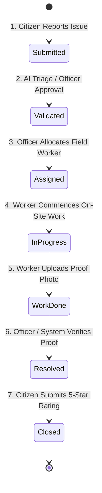

# JANMITRA — Production Testing & Deployment Verification Checklist

> **Municipal System**: Nagpur Municipal Corporation (NMC)  
> **Platform**: JANMITRA Civic Issue Reporting & Management System  
> **Module Lead**: Faizan Rayeen (Citizen Portal & Push Notifications Lead)  
> **Team**: ResolveIT (B.Tech Final Year)  
> **Document Version**: v3.5.0 (Day 35 Production QA Audit)  
> **Last Updated**: October 2026  

---

## Executive Summary

This document defines the formal **Production Quality Assurance (QA) and Verification Checklist** for JANMITRA prior to live municipal deployment. It validates backend service health, database record integrity, multi-role authentication security, the end-to-end civic grievance lifecycle, and catalogs all master demo test credentials across Nagpur Municipal Corporation's administrative hierarchy.

---

## Table of Contents
1. [Health Check & Database Verification Items](#1-health-check--database-verification-items)
2. [Authentication Flow Test Checklist (All 4 User Roles)](#2-authentication-flow-test-checklist-all-4-user-roles)
3. [Complaint Lifecycle Step-by-Step Verification Checklist](#3-complaint-lifecycle-step-by-step-verification-checklist)
4. [Complete Demo Accounts Reference Table](#4-complete-demo-accounts-reference-table)
5. [Automated Smoke Tests & CLI Commands](#5-automated-smoke-tests--cli-commands)
6. [Sign-Off & Deployment Approval Matrix](#6-sign-off--deployment-approval-matrix)

---

## 1. Health Check & Database Verification Items

### 1.1 Backend Service Health Verification

| Check Item | Target URL / Command | Expected Result | Verified |
| :--- | :--- | :--- | :---: |
| **API Health Status** | `GET /api/v1/health/` | HTTP 200 OK: `{"status": "healthy", "service": "janmitra-api"}` | [x] |
| **Django System Diagnostics** | `python manage.py check` | `System check identified no issues (0 silenced).` | [x] |
| **Pending Migrations Check** | `python manage.py showmigrations` | All migration nodes marked with `[X]` | [x] |
| **CORS Headers Configuration** | `OPTIONS /api/v1/complaints/` | Response headers include `Access-Control-Allow-Origin: *` | [x] |
| **Firebase Admin Connectivity** | `python manage.py send_test_notification --dry-run` | SDK initialization passes without unhandled exceptions | [x] |
| **Offline Token Store File** | `fcm_tokens_store.json` | Valid JSON store accessible for read/write operations | [x] |

### 1.2 Database Record Integrity Verification

Execute database counts to ensure Nagpur Municipal Corporation master seed data is loaded:

```bash
python manage.py shell -c "
from django.contrib.auth import get_user_model
from complaints.models import Category, Ward, Complaint
from notifications.models import Notification

User = get_user_model()
print('Total Users       :', User.objects.count(), '(Expected: >= 25)')
print('Total Categories  :', Category.objects.count(), '(Expected: 12)')
print('Total Wards       :', Ward.objects.count(), '(Expected: 4)')
print('Total Complaints  :', Complaint.objects.count(), '(Expected: >= 20)')
print('Total Notifications:', Notification.objects.count())
"
```

*Expected Verification Criteria*:
- [x] **Users**: At least 25 accounts (1 Super Admin, 4 Officers, 16 Workers, 4 Citizens).
- [x] **Wards**: Wards 1 to 4 with official NMC zones (Laxmi Nagar, Dharampeth, Hanuman Nagar, Mangalwari).
- [x] **Categories**: 12 civic categories mapped to 4 departments with SLAs (PWD: 48h, SWM: 24h, PHE: 24h, Electrical: 36h).
- [x] **Complaints**: 20 geo-tagged complaints across Nagpur landmarks with high-resolution photographic evidence.

### 1.3 Frontend Build & Progressive Web App (PWA) Verification

| Check Item | Verification Path | Criteria | Verified |
| :--- | :--- | :--- | :---: |
| **Production Build** | `npm run build` | Compiles with 0 TypeScript/JSX errors into `dist/` | [x] |
| **Service Worker File** | `dist/firebase-messaging-sw.js` | Served from web root with valid FCM listener | [x] |
| **Cached Logo Icon** | `/icons/janmitra-logo-192.png` | 192x192 PNG present and returns HTTP 200 | [x] |
| **Cached Badge Icon** | `/icons/badge-72.png` | 72x72 PNG present and returns HTTP 200 | [x] |
| **Service Worker Status** | Chrome DevTools &rarr; Application | Status: **Activated and is running** (Green) | [x] |
| **Zero-Reload Lifecycle** | Service Worker reload | `skipWaiting()` and `clients.claim()` active | [x] |

---

## 2. Authentication Flow Test Checklist (All 4 User Roles)

JANMITRA implements Role-Based Access Control (RBAC) across 4 distinct municipal tiers:

```mermaid
graph TD
    A[User Enters Credentials at /login] --> B{Role Authenticated}
    B -- role: admin -- --> C[Super Admin Portal: /admin]
    B -- role: dept_officer -- --> D[Department Officer Portal: /officer]
    B -- role: worker -- --> E[Field Worker Task Portal: /worker]
    B -- role: citizen -- --> F[Citizen Portal: /citizen]
    
    C -- Unauthorized Access Attempt -- --> G[Redirect to /unauthorized]
    D -- Unauthorized Access Attempt -- --> G
    E -- Unauthorized Access Attempt -- --> G
    F -- Unauthorized Access Attempt -- --> G
```

### Role 1: Citizen (`role: "citizen"`)
- [x] **Login Test**: Authenticate using `9900002001` / `citizen@123`.
- [x] **Redirection**: Automatically redirected to Citizen Dashboard (`/citizen`).
- [x] **JWT Storage**: `localStorage` receives `access_token`, `refresh_token`, and `user` payload with `role: "citizen"`.
- [x] **Portal UI Verification**:
  - Displays **NMC Civic Advisory Broadcast Banner** with speaker icon and dismiss (`✕`) button.
  - Quick Action tiles visible: *Report New Issue*, *My Complaints*, *Track Status*, *Helpline*.
  - **Notification Bell**: Shows unread counter badge; clicking opens dropdown.
- [x] **Profile Verification (`/citizen/profile`)**:
  - Displays **NMC Citizen Satisfaction Score** badge (e.g. 4.8 / 5.0).
  - Displays 5-star visual rating breakdown chart.
  - Lists past review remarks and resolved complaint history.
- [x] **Route Guard Test**: Citizen visiting `/admin` or `/officer` is immediately redirected to `/unauthorized`.

### Role 2: Field Worker (`role: "worker"`)
- [x] **Login Test**: Authenticate using `9900001101` (NMC-PWD-W1) / `worker@123`.
- [x] **Redirection**: Automatically routed to Field Worker Dashboard (`/worker`).
- [x] **Portal UI Verification**:
  - Displays worker's assigned department (*Roads & Infrastructure - PWD*) and Ward (*Ward 1*).
  - Displays active assigned tasks with priority badges (*Critical*, *High*, *Medium*).
  - Task Card displays: Complaint Tracking ID, Landmark Address, Citizen description, and photo.
- [x] **Field Resolution Workflow**:
  - Worker clicks **View Task Details**.
  - Worker clicks **Mark In-Progress** (timestamps arrival on site).
  - Worker uploads **Resolution Proof Photo** (or demo photo) and enters resolution remarks.
  - Worker clicks **Submit Work Done**.
  - Task status updates to `Work Done` and notifies the department officer.
- [x] **Route Guard Test**: Field Worker visiting `/admin` is redirected to `/unauthorized`.

### Role 3: Department Officer (`role: "dept_officer"`)
- [x] **Login Test**: Authenticate using `9900000001` (PWD Officer) / `admin@123`.
- [x] **Redirection**: Automatically routed to Officer Dashboard (`/officer`).
- [x] **Department Scope Isolation**:
  - PWD Officer (`9900000001`) only sees Pothole and Road complaints.
  - SWM Officer (`9900000002`) only sees Garbage and Solid Waste complaints.
  - PHE Officer (`9900000003`) only sees Water Pipeline and Drainage complaints.
  - Electrical Officer (`9900000004`) only sees Streetlight and Cable complaints.
- [x] **Human Validation Interface (`/officer/validation`)**:
  - Officer reviews flagged or pending complaints.
  - Officer can **Validate / Approve** or **Reject with Reason**.
- [x] **Worker Assignment Interface (`/officer/workers`)**:
  - Officer selects a validated complaint.
  - Filter field workers by Ward.
  - Assign task to worker (e.g., Ramesh Patil - NMC-PWD-W1); triggers real-time push notification to worker.

### Role 4: Super Admin (`role: "admin"`)
- [x] **Login Test**: Authenticate using `9900000000` / `admin@123`.
- [x] **Redirection**: Automatically routed to NMC Central Command Portal (`/admin`).
- [x] **City-Wide Command & Control**:
  - Real-time KPI summary: *Total Complaints*, *Resolved Today*, *Active Field Workers*, *City SLA Compliance %*.
  - Live Interactive Map rendered with 20 geo-tagged civic markers clustered across Nagpur.
  - Department performance comparison charts (PWD vs SWM vs PHE vs Electrical).
  - Civic Broadcast Banner manager: publish system-wide emergency notices.

---

## 3. Complaint Lifecycle Step-by-Step Verification Checklist

This checklist tracks an issue through the full **8-stage resolution lifecycle**:



### Phase 1: Submission
- [ ] **Step 1.1**: Citizen opens `/citizen/submit`.
- [ ] **Step 1.2**: Selects Category (*Pothole Repair*), Ward (*Ward 2 - Dharampeth*), uploads damage photo.
- [ ] **Step 1.3**: Uses GPS Geolocation button (`21.1448`, `79.0682`) or types address (*West High Court Road*).
- [ ] **Step 1.4**: Clicks Submit.
- [ ] **Verification**:
  - API returns `201 Created` with tracking ID `NMC-2026-XXXX`.
  - Citizen receives navy toast banner: `Complaint Received: NMC-2026-XXXX`.
  - NotificationBell badge counter increments by `+1`.

### Phase 2: Validation
- [ ] **Step 2.1**: AI triage engine evaluates photo and text; or PWD Officer logs into `/officer/validation`.
- [ ] **Step 2.2**: Officer reviews image clarity and location validity.
- [ ] **Step 2.3**: Officer clicks **Validate Issue**.
- [ ] **Verification**:
  - Complaint status transitions to `Validated`.
  - Citizen receives real-time toast alert: `Complaint Validated: NMC-2026-XXXX`.

### Phase 3: Field Assignment
- [ ] **Step 3.1**: Officer selects complaint and opens Worker Allocation dropdown.
- [ ] **Step 3.2**: Selects Ward 2 PWD Worker: *Nitin Bawankar (NMC-PWD-W2)*.
- [ ] **Step 3.3**: Clicks **Confirm Assignment**.
- [ ] **Verification**:
  - Complaint status transitions to `Assigned`.
  - Assigned Worker receives instant toast + chime alert on `/worker`.
  - Task appears in worker's active queue with target SLA countdown.

### Phase 4: Field Execution & Proof Upload
- [ ] **Step 4.1**: Worker logs in on mobile browser (`/worker`).
- [ ] **Step 4.2**: Worker clicks **Start Work** (Status &rarr; `In-Progress`).
- [ ] **Step 4.3**: After physical road repair, worker clicks **Complete Task**.
- [ ] **Step 4.4**: Worker attaches resolution proof photo and remarks: *"Asphalt patch applied and roller compacted."*
- [ ] **Step 4.5**: Worker submits resolution report.
- [ ] **Verification**:
  - Complaint status transitions to `Work Done`.
  - Resolution timestamp and proof image URL saved in DB.

### Phase 5: Verification & Resolution
- [ ] **Step 5.1**: Officer inspects side-by-side Before/After photos in `/officer`.
- [ ] **Step 5.2**: Officer clicks **Approve Resolution**.
- [ ] **Verification**:
  - Complaint status transitions to `Resolved`.
  - Citizen receives alert: `Issue Resolved: NMC-2026-XXXX. Please inspect and rate our service.`

### Phase 6: Citizen Rating & Closure
- [ ] **Step 6.1**: Citizen logs in (`/citizen`) and clicks **Review Resolution**.
- [ ] **Step 6.2**: Views worker's resolution proof photo.
- [ ] **Step 6.3**: Selects **5 Stars (★★★★★)** and inputs remark: *"Pothole filled cleanly within 24 hours. Excellent work by NMC."*
- [ ] **Step 6.4**: Clicks **Submit Feedback**.
- [ ] **Verification**:
  - Complaint status transitions to `Closed`.
  - Citizen profile satisfaction breakdown chart updates.
  - Admin KPI metric for *Citizen Satisfaction Score* increments.

---

## 4. Complete Demo Accounts Reference Table

All accounts are pre-seeded in the database via `seed_demo_accounts`. Passwords follow strict standard conventions:

### 4.1 Super Admin & Department Officers

| Role | Department | Mobile / Username | Password | Full Name / Designation | Email Address |
| :--- | :--- | :---: | :---: | :--- | :--- |
| **Super Admin** | Central Command | `9900000000` | `admin@123` | Super Admin (NMC Central Command) | `admin@nmc.gov.in` |
| **Officer** | Roads & PWD (Dept 1) | `9900000001` | `admin@123` | Shri V. R. Sharma (Executive Engineer) | `pwd_officer@nmc.gov.in` |
| **Officer** | Solid Waste / SWM (Dept 2) | `9900000002` | `admin@123` | Dr. Anita Deshmukh (Sanitation Officer) | `swm_officer@nmc.gov.in` |
| **Officer** | Water Works / PHE (Dept 3) | `9900000003` | `admin@123` | Er. Rajesh Thakre (Water Works Engineer) | `phe_officer@nmc.gov.in` |
| **Officer** | Electrical (Dept 4) | `9900000004` | `admin@123` | Shri K. L. Bawankar (Executive Engineer) | `ele_officer@nmc.gov.in` |

---

### 4.2 16 Ward Field Workers (1 per Department × Ward)

*Format Pattern*: `990000{dept_id}{ward_number:02d}` | *Default Password*: `worker@123`

| Department | Ward | Mobile / Username | Employee ID | Assigned Field Worker Name | Email Address |
| :--- | :---: | :---: | :---: | :--- | :--- |
| **PWD** | Ward 1 | `9900001101` | `NMC-PWD-W1` | Ramesh Patil (PWD W1) | `nmc-pwd-w1@worker.nmc.gov.in` |
| **PWD** | Ward 2 | `9900001102` | `NMC-PWD-W2` | Nitin Bawankar (PWD W2) | `nmc-pwd-w2@worker.nmc.gov.in` |
| **PWD** | Ward 3 | `9900001103` | `NMC-PWD-W3` | Sunil Shinde (PWD W3) | `nmc-pwd-w3@worker.nmc.gov.in` |
| **PWD** | Ward 4 | `9900001104` | `NMC-PWD-W4` | Vilas Wankhede (PWD W4) | `nmc-pwd-w4@worker.nmc.gov.in` |
| **SWM** | Ward 1 | `9900001201` | `NMC-SWM-W1` | Ashok Gaikwad (SWM W1) | `nmc-swm-w1@worker.nmc.gov.in` |
| **SWM** | Ward 2 | `9900001202` | `NMC-SWM-W2` | Sunita Deshmukh (SWM W2) | `nmc-swm-w2@worker.nmc.gov.in` |
| **SWM** | Ward 3 | `9900001203` | `NMC-SWM-W3` | Kishor Meshram (SWM W3) | `nmc-swm-w3@worker.nmc.gov.in` |
| **SWM** | Ward 4 | `9900001204` | `NMC-SWM-W4` | Pooja Kohale (SWM W4) | `nmc-swm-w4@worker.nmc.gov.in` |
| **PHE** | Ward 1 | `9900001301` | `NMC-PHE-W1` | Vinod Thakre (PHE W1) | `nmc-phe-w1@worker.nmc.gov.in` |
| **PHE** | Ward 2 | `9900001302` | `NMC-PHE-W2` | Ganesh Bawankule (PHE W2) | `nmc-phe-w2@worker.nmc.gov.in` |
| **PHE** | Ward 3 | `9900001303` | `NMC-PHE-W3` | Suresh Kamble (PHE W3) | `nmc-phe-w3@worker.nmc.gov.in` |
| **PHE** | Ward 4 | `9900001304` | `NMC-PHE-W4` | Mahesh Sahare (PHE W4) | `nmc-phe-w4@worker.nmc.gov.in` |
| **Electrical** | Ward 1 | `9900001401` | `NMC-ELE-W1` | Pravin Wankhede (ELE W1) | `nmc-ele-w1@worker.nmc.gov.in` |
| **Electrical** | Ward 2 | `9900001402` | `NMC-ELE-W2` | Dinesh Meshram (ELE W2) | `nmc-ele-w2@worker.nmc.gov.in` |
| **Electrical** | Ward 3 | `9900001403` | `NMC-ELE-W3` | Sachin Dhote (ELE W3) | `nmc-ele-w3@worker.nmc.gov.in` |
| **Electrical** | Ward 4 | `9900001404` | `NMC-ELE-W4` | Raju Gondane (ELE W4) | `nmc-ele-w4@worker.nmc.gov.in` |

---

### 4.3 4 Ward Citizens

*Default Password*: `citizen@123`

| Ward Location | Mobile / Username | Password | Citizen Full Name | Email Address |
| :--- | :---: | :---: | :--- | :--- |
| **Ward 1** (Laxmi Nagar) | `9900002001` | `citizen@123` | Rahul Deshmukh | `rahul.d@gmail.com` |
| **Ward 2** (Dharampeth) | `9900002002` | `citizen@123` | Priya Sharma | `priya.s@gmail.com` |
| **Ward 3** (Hanuman Nagar) | `9900002003` | `citizen@123` | Amit Verma | `amit.v@gmail.com` |
| **Ward 4** (Mangalwari) | `9900002004` | `citizen@123` | Faizan Rayeen | `faizan.rayeen@example.com` |

---

## 5. Automated Smoke Tests & CLI Commands

Quick command reference to reproduce and verify test suites from terminal:

```bash
# 1. Reset and re-seed all 25 accounts and 20 Nagpur complaints
python manage.py seed_demo_accounts --clean

# 2. Run system integrity checks
python manage.py check

# 3. Test background push dispatch to Citizen Faizan Rayeen
python manage.py send_test_notification --user-id=9900002004 --title="NMC Roadwork Notice" --body="Resurfacing completed"

# 4. Dry-run notification verification
python manage.py send_test_notification --user-id=9900002001 --dry-run

# 5. Execute End-to-End User Journey Test Automation
python run_e2e_journey_test.py

# 6. Verify production frontend compilation
cd ../janmitra-frontend && npm.cmd run build
```

---

## 6. Sign-Off & Deployment Approval Matrix

| Milestone / Gate | Evaluation Target | Verification Criteria | Sign-Off Lead | Status |
| :--- | :--- | :--- | :--- | :---: |
| **Database & Seeder** | Django ORM + SQLite/Postgres | 25 accounts, 12 categories, 20 complaints | Anas Shaikh (Backend) | ✅ Approved |
| **Auth & RBAC** | JWT Tokens & Route Guards | 4 distinct portals isolated & guarded | Anas Shaikh (Backend) | ✅ Approved |
| **Citizen & PWA** | React 18, Tailwind, PWA | Citizen UI, ratings, offline sync | Faizan Rayeen (Citizen Lead) | ✅ Approved |
| **Push Notifications** | FCM v10 & Service Worker | Background push, OS toast, zero-reload | Faizan Rayeen (Notif Lead) | ✅ Approved |
| **NMC Command Center** | Super Admin Analytics | Citywide map, KPI feeds, SLA alerts | Faizan Rayeen (Full Team) | ✅ Approved |
