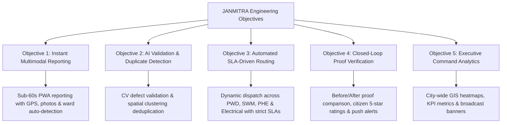

# Chapter 1: Introduction

---

## 1.1 Background of Urban Local Bodies (ULBs) and Civic Complaint Handling

Urban Local Bodies (ULBs) form the foundational third tier of democratic governance in India, formalized through the landmark **74th Constitutional Amendment Act of 1992**. Entrusted with the governance of cities and towns, Municipal Corporations (Mahanagar Palikas) bear the constitutional and administrative responsibility of delivering vital public infrastructure and basic municipal utilities. These responsibilities encompass urban road maintenance, solid waste collection and scientific disposal, stormwater drainage, domestic water supply engineering, public street lighting, and environmental health preservation.

As India undergoes rapid urban transition, Tier-I and Tier-II metropolitan centers are experiencing unprecedented spatial expansion and demographic pressure. **Nagpur**, the third-largest city in Maharashtra and the designated winter capital of the state, exemplifies this rapid urban trajectory. Administered by the **Nagpur Municipal Corporation (NMC)**, the city spans an area of over 227.67 square kilometers organized into 10 administrative zones and over 150 municipal wards, catering to a burgeoning population exceeding 2.5 million residents.

In municipal administration, **Civic Grievance Redressal** serves as the primary touchpoint between citizens and the municipal authority. It is widely acknowledged as the single most critical barometer of local governance efficacy, transparency, and civic trust. Under conventional municipal operating procedures, citizen grievance reporting has historically relied upon fragmented, manual, and analogue mechanisms:
1. **Physical Petitions**: Citizens are required to visit designated Zonal or Ward Offices during working hours to draft and hand-deliver physical paper complaint letters to ward clerks.
2. **Telephonic Helplines & Control Rooms**: Inbound call center numbers where municipal operators transcribe verbal citizen complaints into physical ledger registers or siloed desktop software without spatial coordinates.
3. **Informal Digital Inboxes**: Ad-hoc WhatsApp helplines, generic municipal email addresses, and municipal social media handles (e.g., Twitter/X tags) that lack structured schema, standardized validation, or workflow automation.

While these legacy reporting channels were adequate for low-density urban centers of previous decades, they have collapsed under the operational scale of contemporary metropolitan centers. The operational disconnect between citizen grievance reporting, departmental triage, field-worker dispatch, and administrative auditing represents a critical technological bottleneck in urban governance.

---

## 1.2 Problem Statement: Absence of Automated Tracking and Verification in NMC

Despite substantial modernization investments under initiatives such as the **Smart Cities Mission** and **Digital India**, municipal grievance management within the Nagpur Municipal Corporation continues to suffer from severe structural and technical inefficiencies. The absence of an end-to-end automated, spatially grounded, and verifiable digital grievance pipeline results in widespread service failures, categorized below:

```
┌───────────────────────────────────────────────────────────────────────────────┐
│              LEGACY MUNICIPAL GRIEVANCE BOTTLENECK CYCLE                      │
├───────────────────────────────────────────────────────────────────────────────┤
│                                                                               │
│   [Citizen Report]                                                            │
│          │ (Ambiguous text description, no GPS coordinates, no photo)         │
│          ▼                                                                    │
│   [Manual Triage Desk]                                                        │
│          │ (Paper handoff delay: 4 to 12 days across wrong departments)       │
│          ▼                                                                    │
│   [Field Allocation Deficit]                                                  │
│          │ (Workers lack structured tasks, GPS navigation, or priority queue) │
│          ▼                                                                    │
│   [Ghost Resolution]                                                          │
│          │ (Issue marked "Done" on paper without proof-of-work photo)         │
│          ▼                                                                    │
│   [Citizen Disillusionment & Duplicate Storm]                                 │
│            (Citizens re-file same issue multiple times, choking system)       │
│                                                                               │
└───────────────────────────────────────────────────────────────────────────────┘
```

### 1.2.1 Lack of Geospatial Precision and Visual Context
Conventional complaint mechanisms capture text descriptions that are inherently vague, colloquial, and devoid of geospatial context (e.g., *"Large pothole opposite the temple near medical square"*). Field inspection crews dispatched by the Public Works Department (PWD) frequently waste hours attempting to identify the exact defect location, or miss the defect entirely. Furthermore, the absence of initial photographic evidence prevents municipal engineers from assessing defect severity, required machinery (e.g., asphalt roller vs. cold patch), or material tonnage before field deployment.

### 1.2.2 The "Black Box" Phenomenon and Citizen Disillusionment
Once a citizen registers a complaint through existing helplines, the grievance enters an opaque administrative "black box." The citizen receives either no tracking identifier or a static reference number that yields no actionable status updates. Citizens are left unaware of whether their issue was reviewed, categorized, assigned, or dismissed. This lack of transparency fosters profound civic cynicism, prompting citizens to repeatedly lodge duplicate complaints across multiple channels (phone, Twitter, ward visits), severely overloading municipal administrative staff.

### 1.2.3 Manual, Error-Prone, and Delayed Departmental Triage
Under the manual framework, incoming grievances must be manually read, interpreted, and routed by municipal data-entry operators. A pothole complaint accompanied by water pipeline damage is frequently misrouted between the *Public Works Department (PWD)* and the *Public Health Engineering Department (PHE)*. This inter-departmental ping-pong routinely consumes 5 to 14 days before a complaint reaches the appropriate junior engineer, during which public hazards worsen.

### 1.2.4 The Proof-of-Work Deficit and "Ghost Resolutions"
A major vulnerability in municipal governance is the systemic lack of accountability in field work execution. Currently, municipal field workers or private maintenance contractors report issue resolution through verbal confirmations or paper sign-offs. Because there is no mandatory digital requirement to upload verifiable, geo-tagged **Before-and-After photographic proof**, significant numbers of complaints are marked as "Resolved" in municipal registers while remaining completely unaddressed on the ground—a phenomenon termed **"Ghost Resolution."**

### 1.2.5 Absence of Closed-Loop Citizen Sign-Off and Quality Feedback
In traditional ULB operations, the grievance lifecycle terminates unilaterally when the municipal officer closes the ticket. The affected citizen—who originally reported the problem and lives in the impacted neighborhood—is granted no mechanism to verify the quality of the repair, rate the responsiveness of the field team, or reopen substandard work. The accountability loop remains fundamentally broken.

### 1.2.6 Lack of Executive-Level Geospatial Analytics
Municipal Commissioners, Additional Commissioners, and Ward Officers lack real-time, spatial decision-support dashboards. Without aggregated geospatial heatmaps displaying defect clustering, department-wise SLA violations, and worker utilization rates, municipal leadership is forced to manage urban infrastructure reactively rather than proactively.

---

## 1.3 Project Objectives

To dismantle these structural bottlenecks, **JANMITRA** (*People's Civic Companion*) was conceptualized and engineered by Team **ResolveIT**. JANMITRA is an enterprise-grade, crowdsourced civic issue reporting, automated triage, and closed-loop resolution platform tailored specifically for the municipal workflows of the **Nagpur Municipal Corporation (NMC)**. 

The core research and engineering objectives of the project are defined as follows:



### Objective 1: Instant, Frictionless, and Multimodal Civic Reporting
To engineer an ultra-responsive, mobile-first Progressive Web Application (PWA) that empowers citizens of Nagpur to capture and submit verifiable civic grievances in under 60 seconds. The reporting pipeline automatically binds high-resolution camera imagery, high-precision GPS spatial coordinates (latitude/longitude), reverse-geocoded landmark addresses, and automated municipal ward boundary detection.

### Objective 2: AI-Assisted Defect Validation and Spatial Duplicate Mitigation
To integrate computer vision classification and deep-learning triage models capable of evaluating citizen image submissions. The validation engine ensures submitted images depict genuine civic infrastructure failures, categorizes defect severity, rejects irrelevant or obscene uploads, and executes spatial-radius clustering algorithms to identify and merge duplicate reports filed by multiple citizens within the same vicinity.

### Objective 3: Dynamic SLA-Driven Departmental Routing and Task Allocation
To implement a robust, rule-based dispatch engine that immediately routes validated complaints to the appropriate municipal department (**PWD**, **SWM**, **PHE**, **Electrical**) and designated Ward Engineers based on automated spatial and categorical indexing. The system enforces strict, department-specific **Service Level Agreements (SLAs)** with automated escalation protocols for unassigned or delayed tasks.

### Objective 4: Closed-Loop Proof-of-Work Verification and Real-Time Push Alerts
To establish an unbreachable accountability loop requiring field workers to upload timestamped, geo-tagged resolution proof photographs from the physical site prior to ticket closure. Concurrently, to engineer an asynchronous dual-channel notification pipeline (Firebase Cloud Messaging v10 + W3C Service Worker) that delivers instant foreground toast banners and background OS system tray alerts to citizens, workers, and officers across all key state transitions.

### Objective 5: Citizen Feedback Rating and Executive Command Analytics
To empower citizens to inspect resolution photographic proof, submit quantitative 1-to-5 star satisfaction ratings, and record qualitative feedback remarks that directly feed into the municipal **NMC Citizen Satisfaction Score**. Simultaneously, to provide city administrators with a centralized Command & Control dashboard featuring interactive GIS defect clustering, SLA compliance charts, and broadcast advisory capabilities.

---

## 1.4 Scope and Limitations of the Project

To ensure academic rigor, technical depth, and thorough field validation within the engineering development lifecycle, the implementation parameters of JANMITRA have been defined with clear scopes and operational constraints.

### 1.4.1 Project Scope (Core Focus Areas)

The pilot deployment and functional architecture of JANMITRA encompass the administrative jurisdiction of the **Nagpur Municipal Corporation (NMC)**, focusing on four primary civic departments and four representative municipal wards:

```
┌──────────────────────────────────────────────────────────────────────────────────┐
│                     JANMITRA PILOT IMPLEMENTATION SCOPE                          │
├──────────────────────────────────────────────────────────────────────────────────┤
│                                                                                  │
│   FOUR MUNICIPAL DEPARTMENTS              FOUR REPRESENTATIVE WARDS              │
│   ──────────────────────────              ─────────────────────────              │
│   1. Public Works Department (PWD)        • Ward 1: Laxmi Nagar (South-West)     │
│   2. Solid Waste Management (SWM)         • Ward 2: Dharampeth (West Nagpur)     │
│   3. Public Health Engineering (PHE)      • Ward 3: Hanuman Nagar (South-East)   │
│   4. Electrical Department                • Ward 4: Mangalwari (North Nagpur)    │
│                                                                                  │
│   FOUR ROLE-BASED PORTALS                 TWENTY-FIVE MASTER DEMO ACCOUNTS       │
│   ───────────────────────                 ────────────────────────────────       │
│   • Citizen Portal (/citizen)             • 1 Super Administrator (Central)      │
│   • Field Worker Portal (/worker)         • 4 Departmental Executive Engineers   │
│   • Department Officer Portal (/officer)  • 16 Ward Field Technicians (4x4)      │
│   • Central Command Center (/admin)       • 4 Ward Citizen Personas              │
│                                                                                  │
└──────────────────────────────────────────────────────────────────────────────────┘
```

#### 1. Departmental and Category Taxonomy
The platform models twelve mission-critical civic defect categories across four core departments, each governed by municipal SLA resolution timelines:
- **Public Works Department (PWD / Dept 1)**: Pothole Repair (SLA: 48h), Road Surface Sinking & Asphalt Degradation (SLA: 48h), Footpath & Paver Block Disrepair (SLA: 72h).
- **Solid Waste Management (SWM / Dept 2)**: Overflowing Community Dustbins (SLA: 24h), Unattended Street Garbage Dumps (SLA: 24h), Construction Debris & Demolition Waste (SLA: 48h).
- **Public Health Engineering (PHE / Dept 3)**: Potable Water Pipeline Leakage (SLA: 24h), Open Drainage & Sewer Line Choke (SLA: 36h), Contaminated Water Supply (SLA: 24h).
- **Electrical Department (Dept 4)**: Non-Functional Street Lighting & Dark Spots (SLA: 36h), High-Voltage Cable Faults & Hanging Wires (SLA: 24h), High Mast Light Repairs (SLA: 48h).

#### 2. Geographic Ward Pilot
The pilot implementation encompasses four geographically and socio-economically diverse municipal wards across Nagpur:
- **Ward 1 (Laxmi Nagar)**: High-density residential and commercial zone in South-West Nagpur.
- **Ward 2 (Dharampeth)**: Major commercial, institutional, and mixed-use corridor in West Nagpur (including West High Court Road and Shankar Nagar).
- **Ward 3 (Hanuman Nagar)**: Dense suburban residential and educational locality in South-East Nagpur.
- **Ward 4 (Mangalwari)**: Rapidly growing urban residential and transit zone in North Nagpur.

#### 3. Enterprise Role-Based Access Control (RBAC)
The software models all four tiers of municipal hierarchy with strict access boundaries:
1. **Citizens**: Public reporting, live status tracking, push notifications, and 5-star resolution rating.
2. **Field Technicians**: Dedicated mobile dashboard with task cards, site navigation, and proof-of-work photo upload.
3. **Department Officers**: Department-filtered validation desk, manual review overrides, and field worker dispatch.
4. **Super Administrator**: Central municipal command with city-wide GIS maps, cross-department KPI benchmarking, and civic broadcast management.

---

### 1.4.2 Project Limitations and Constraints

While engineered to production standards, the current academic and prototype implementation operates under the following identified limitations:

| Domain | Operational Constraint | Engineering Rationale / Mitigation |
| :--- | :--- | :--- |
| **Geographic Coverage** | Limited to 4 pilot wards (Wards 1–4) out of NMC's 150+ wards. | Selected to establish a rigorous, validated baseline across all four departments prior to citywide infrastructure rollout. |
| **Departmental Scope** | Limited to 4 core infrastructure departments (PWD, SWM, PHE, Electrical). | Excludes non-infrastructure municipal functions such as Property Tax assessments, Trade Licensing, and Tree Trimming. |
| **Computer Vision Context** | AI image validation models are optimized for outdoor daylight imagery. | Extreme night-time imagery or low-illumination photos may require manual review by the Department Officer via `/officer/validation`. |
| **Push Notification Network** | Web Push delivery relies on standard Google FCM ports (5228–5230). | Firewalled campus networks or offline mobile states automatically engage JANMITRA's Safe Simulation Mode and IndexedDB offline sync. |
| **Hardware Dependencies** | Geolocation precision depends on user device GPS hardware accuracy. | The platform provides an interactive Leaflet map pin-drop fallback allowing citizens to fine-tune defect location manually. |

---

## 1.5 Organization of the Project Report

This final engineering project report is systematically structured into six cohesive chapters, documenting the complete software engineering lifecycle of JANMITRA:

### Chapter 1: Introduction
Establishes the municipal governance context of Urban Local Bodies, articulates the problem statement characterizing legacy grievance redressal in the Nagpur Municipal Corporation, formulates the engineering project objectives, defines the operational scope and constraints, and outlines the organizational roadmap of the report.

### Chapter 2: Literature Review and Related Work
Conducts an in-depth academic survey of contemporary digital governance platforms, including the Government of India's Centralized Public Grievance Redress and Monitoring System (**CPGRAMS**), the Ministry of Housing and Urban Affairs' **Swachhata App**, and international municipal 311 citizen services (e.g., NYC 311, Boston Citizen Connect). Analyzes technological gaps in automated computer vision triage, geospatial clustering deduplication, and proof-of-work verification models.

### Chapter 3: System Requirements and Architectural Design
Presents the formal Software Requirements Specification (SRS), IEEE-compliant functional and non-functional requirements, use-case specifications, and actor interaction models. Details the three-tier micro-modular architecture, decoupled RESTful API contracts, relational database Entity-Relationship (ER) schemas, and security frameworks governing authentication and Role-Based Access Control (RBAC).

### Chapter 4: System Methodology and Implementation Details
Provides an exhaustive technical walkthrough of the core software implementation. Discusses the React 18 / Tailwind CSS Progressive Web Application frontend, Django 5.x / Django REST Framework backend services, AI-assisted computer vision validation pipelines, the Firebase Cloud Messaging v10 notification engine with W3C Service Worker background caching, and the master database seeder automation commands.

### Chapter 5: Testing, Experimental Results, and Performance Audit
Details the rigorous verification, testing, and quality assurance methodologies applied to JANMITRA. Covers unit test suites, cross-portal role-based integration testing, end-to-end civic complaint lifecycle audits, network latency and payload benchmarks, and live dual-screen push notification delivery evaluations across active, inactive, and offline states.

### Chapter 6: Conclusion and Future Scope
Synthesizes the key engineering achievements and socio-technical contributions of the JANMITRA platform. Discusses municipal operational takeaways, policy implications for urban local bodies, and outlines future architectural trajectories, including IoT acoustic leak sensor integration, edge AI inferencing, drone-assisted road surface surveys, and expansion across all municipal corporations in the Vidarbha region.

---

```
                       END OF CHAPTER 1: INTRODUCTION
================================================================================
```
